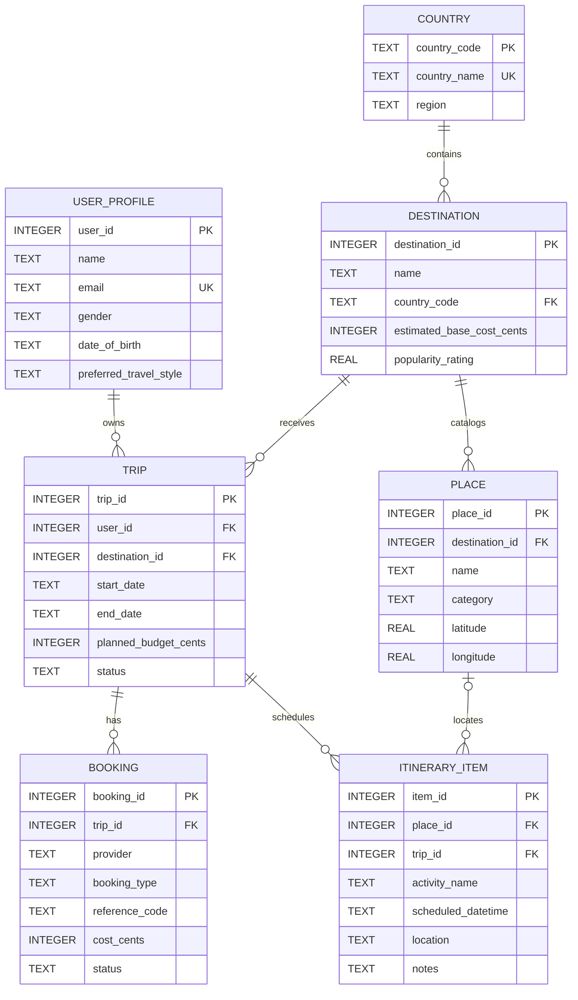

# VoySync database notes

The current schema extends the original six-table group design with a reusable place catalog and optional scheduling. `server/db/schema.sql` contains the executable tables and integrity rules. The application creates a persistent `server/db/voysync.db` on first launch and inserts fictional demo records only for the initial database.

## Relationships

Profiles and destinations may have no trips. Countries may have no destinations. Trips may have no bookings or activities. Each child row has exactly one required parent.

## Integrity and values

- All seven tables are SQLite `STRICT` tables. Foreign keys are enabled on the database connection.
- Referenced countries, profiles and destinations use `ON DELETE RESTRICT`.
- Booking and itinerary rows use `ON DELETE CASCADE` when their parent trip is purged.
- Email is unique with ASCII case-insensitive comparison; optional profile fields can be null. Gender is free text.
- A country code is two uppercase letters from the catalog. Popularity ranges from 0 to 5.
- Money is nonnegative integer SGD cents. `125050` means SGD 1,250.50. Budget overspend is permitted.
- Trip dates and birth dates must be valid calendar dates. The API also rejects future birth dates.
- Activity times are destination-local strings; no UTC conversion is applied.
- Triggers guard activity insertion and editing as well as parent trip date changes. Both boundary dates are inclusive.
- Booking reference codes are not globally unique: different external providers can use the same reference.

## Application choices

The report leaves allowed lifecycle transitions to the application. This starter allows a planning trip to become confirmed or cancelled, and a confirmed trip to become completed or cancelled. Completed and cancelled trips cannot move to another lifecycle state. Saving without a status change is allowed. The UI and API enforce transitions.

Cancelling a trip retains its related records. A separate purge is allowed only after cancellation and permanently removes its bookings and itinerary. It does not remove shared countries, destinations or user profiles. Booking cancellation is tracked independently, without contacting a provider.

The UI edits trips and activities individually. To move activities outside an existing date range, first widen the trip range, then move the activities, then narrow the range. A future single-action move should perform this sequence in one transaction, as described in the report.

The API also supports creating a trip and an optional initial `itinerary_items` array atomically. Failure to insert any supplied activity rolls back the parent trip and all initial activities. This optional API workflow is not exposed as a combined frontend form.

## Report queries

| Report use case | Required semantics |
| --- | --- |
| Destination directory | Join COUNTRY; cost ascending, region ascending, popularity descending, ID as tie-breaker. |
| Promotion recipients | Nested `IN`; planning or confirmed trips ending on/after the reporting date. Region OR country when both are selected. Only lists recipients. |
| Frequent travelers | Separate correlated counts: at least two noncancelled trips OR at least two noncancelled bookings on noncancelled trips. |
| Undiscovered destinations | `NOT EXISTS` against every retained trip, including cancelled trips. |
| High-budget trips | SQLite `NOT EXISTS` equivalent of `> ALL`: no catalog cost may be greater than or equal to the budget. Equality is excluded. |

Purging historical trips changes these reports, so retained cancellation history and permanent deletion have different consequences. Dashboard booking totals and trip remaining budgets exclude cancelled booking records; consult each report's explicit trip-status filters when comparing totals.

A saved idea has a NULL scheduled_datetime. A date-only value represents an untimed daily stop. A full local datetime schedules a timed activity. A linked place must belong to the trip destination. Custom activities may omit place_id.
