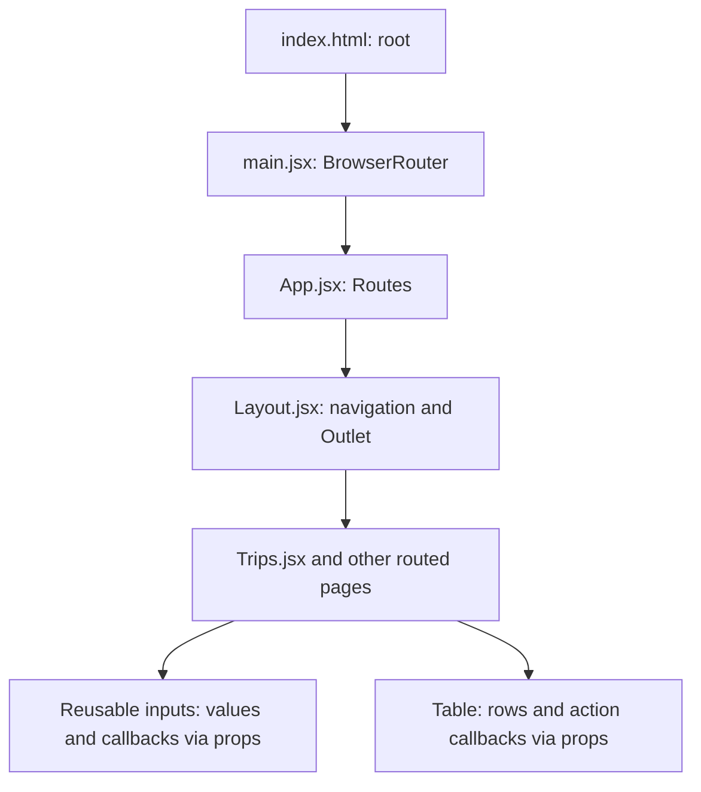
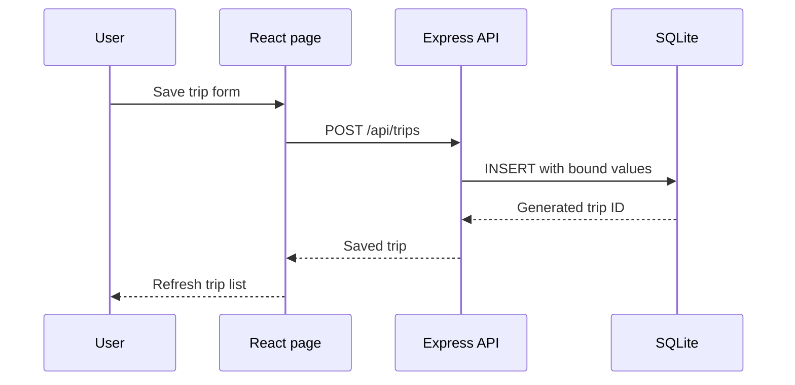

For the current trip planner and Kyoto walkthrough, start with [Plan a trip](../README.md#plan-a-trip). The tutorial below describes the original resource-management screens.

# Week 12 tutorial adapted to VoySync

## 1. Open your project

In VS Code, choose **File > Open Folder** and select `voysync-travel-planner`. Its `client` folder is the equivalent of the tutorial's `online-bookstore` folder. The surrounding project also contains your backend, database and report documents.

The Vite files have already been created. You do not need to run `npm create vite` again inside this project.

## 2. Install and run

Use **Terminal > New Terminal** and run:

```sh
npm install
npm run dev
```

Visit `http://localhost:5173`. Stop both applications with Ctrl+C when finished. On another computer, install Node.js first and then repeat these two commands.

## 3. Follow the React entry points

Read the following files in order:

1. `client/index.html`: the page title and `<div id="root">`.
2. `client/src/main.jsx`: React's root and `BrowserRouter`.
3. `client/src/App.jsx`: the route definitions.
4. `client/src/pages/Layout.jsx`: the shared page shell and `Outlet`.
5. A page such as `Trips.jsx`: its form state, data and event handlers.
6. `client/src/components/`: inputs, navigation and tables used by the pages.



`useState` keeps form values and loaded records synchronized with the view. Handlers passed through props let child components ask a page to change its state. Changing routes renders another page inside the same layout.

## 4. Follow one saved trip

Choose a traveler and a destination, enter the dates and an SGD budget, then save. The page sends those values to `/api/trips`; the Vite proxy forwards that request to Express. A controller validates the request and writes parameterized SQL to SQLite. The generated trip ID links future booking and itinerary rows to that trip.



This request flow extends the Week 12 exercise to connect your frontend to your project database. Individual saves are supported; creating a trip and its initial activities in a single form is not offered.

## 5. Try a complete demo

1. Create a fictional traveler on Profiles.
2. Browse Destinations and create a trip for that traveler.
3. Add a flight or hotel record in Bookings. Use a fictional reference code.
4. Add an activity on Itinerary using a date within that trip.
5. Try an activity outside the trip range and observe the validation error.
6. Review the dashboard and administrator reports.
7. Cancel a test trip. It remains in history and its external reservations are unaffected.
8. If you want to remove that test trip permanently, use its separate purge action and review the confirmation. Associated bookings and activities are removed together.

## 6. Extend it with your team

Use the existing pages as examples when adding components. Keep API routes under `server/routes`, request logic under `server/controllers`, and database definitions under `server/db`. Use the report as the source for names and constraints.

Before using real accounts, plan authentication, authorization, verified email ownership and protected administrator access. A traveler selector or an Admin link is not a security boundary. If adding a combined trip-and-activity workflow or a whole-itinerary date move, wrap all related writes in a transaction so partial updates cannot remain after a failure.

The accompanying project report contains the relational design and the implementation walkthrough.
